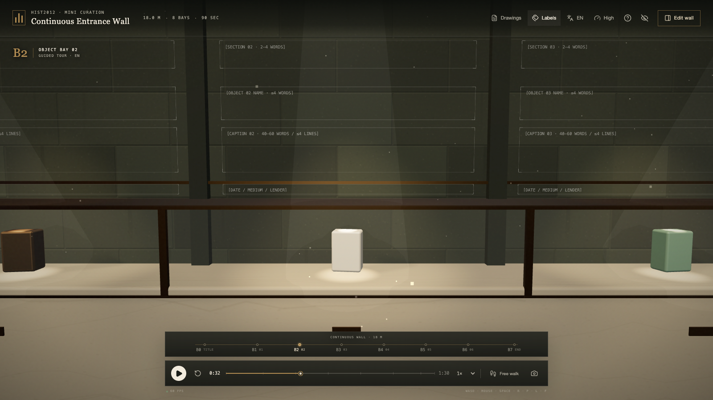

# Continuous Entrance Wall

An interactive 3D museum entrance wall for the HIST2012 mini-curation project: 18 m long, 8 bays, a 90-second guided tour. Built with React, TypeScript, Vite and Three.js. All geometry, textures (procedural masonry, stone, brass), lighting and the environment map are generated in code — the production build is a single self-contained HTML file with no external assets, fonts or CDN requests.



## Features

- **Photoreal-leaning 3D scene** — procedural painted-masonry wall and polished stone floor with bump maps, PMREM environment reflections for brass / glass / floor, rounded stone plinth with brass reveals and a framed glass vitrine, volumetric light cones and drifting dust motes, baked contact shadows and soft PCF shadow mapping.
- **Guided tour** — an 8-station, 90 s camera tour with dwell and transition segments, adjustable speed and a reduced-motion mode.
- **Free exploration** — click the scene and use `W A S D` + mouse look to walk the gallery.
- **Curation editor** — edit every text zone (EN / 中文), import / export `wall.json`, validate against the built-in rules, and import real GLB artefacts into any of the six object bays (proxies are used until a model is placed).
- **Offline & private** — JSON and GLB imports stay on the device; no analytics or network calls.

## Controls

| Key | Action |
| --- | --- |
| `Space` | Pause / continue tour |
| `W A S D` | Enter free walk and move |
| Mouse | Look around in free walk |
| `R` | Return to the title bay (B0) |
| `P` | Show / hide field labels |
| `L` | Switch English / 中文 |
| `F` | Toggle fullscreen |
| `Esc` | Release cursor / close panels |

## Getting started

```bash
npm install
npm run dev        # development server
npm run build      # production build -> dist/ (single self-contained HTML)
```

Open the app with `?tour=1` to start in presentation mode, or `?t=32` to jump the tour to a given second.

## Project layout

```
src/
  scene/WallScene.ts        Three.js scene: architecture, materials, lights, tour, walk
  data/wall.json            default curation (zones, objects, tour)
  lib/validation.ts         wall.json validation rules
  components/               React UI: canvas host, editor, tour controls, docs
public/                     wall.json + JSON schema for external configuration
docs/                       drawings and assignment material
```

## License

MIT
